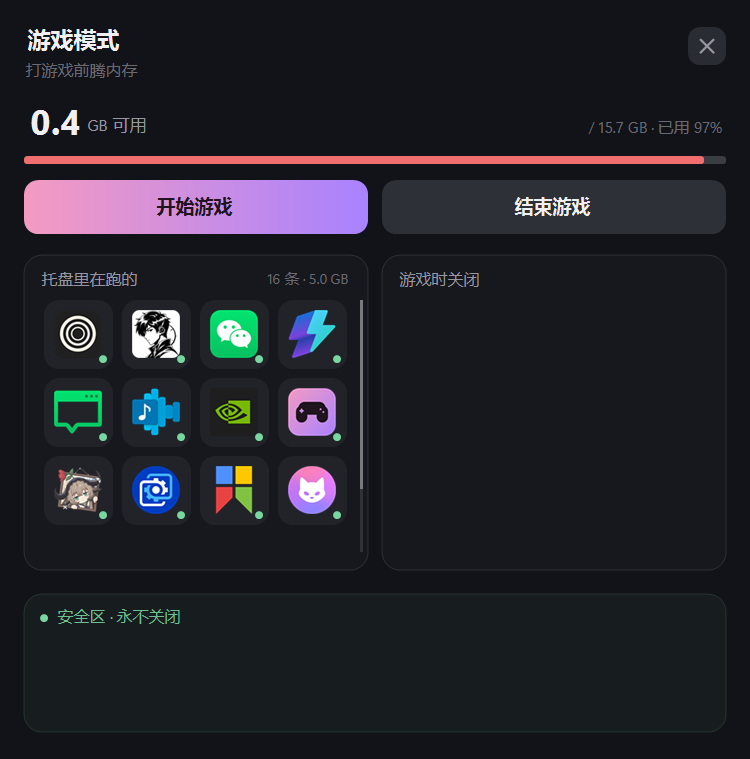

# 游戏模式

打游戏前一键关掉占内存的后台软件，玩完再一键开回来。



## 解决什么问题

Windows 上很多软件关掉窗口还会驻留在托盘：聊天工具、音乐播放器、游戏平台、显卡驱动面板、
网盘同步、输入法、各类辅助工具。单个占几十到几百 MB，加起来能吃掉几个 GB。

16 GB 的机器打大型游戏时，可用内存经常只剩几百 MB，游戏开始卡顿、贴图加载变慢。
手动一个个右键退出很麻烦，而且玩完还得再一个个打开。

这个工具把「关哪几个」记下来，之后就是两次点击。

## 用起来是什么样

界面上三个区：

| 区 | 位置 | 含义 |
|---|---|---|
| 托盘区 | 左上 | 系统托盘里正在运行的应用，自动列出，按内存从大到小排 |
| 关闭区 | 右上 | 点「开始游戏」时要关掉的应用 |
| 安全区 | 下方 | 任何情况下都不关的应用 |

把托盘区的图标拖到关闭区或安全区就完成记录，**记录是永久的**，以后不用再拖。
拖回托盘区不会删除记录，要移出请用右键菜单。

- **开始游戏** —— 关掉关闭区里的应用，并记下关了哪些
- **结束游戏** —— 把上次关掉的重新启动

记录过但当前没运行的应用会灰着显示，开始游戏时跳过，结束游戏时不重启。

## 不在托盘里的应用

有些程序关掉就是真退出、不驻留托盘（比如某些浏览器、游戏启动器），它们不会出现在托盘区。
把它的 exe 或快捷方式从资源管理器**拖进窗口**就能登记，`.lnk` 会自动解析出目标路径。
登记后即使没运行也会显示，标为未运行。

## 配置文件

程序在自身所在目录找 `tray-config.json`，首次运行会自动生成一份默认配置。

| 字段 | 含义 |
|---|---|
| `Protect` | 系统级保护名单，写进程名（不含 .exe）。任何情况下都不碰，默认空 |
| `Tracked` | 手动登记的 exe 全路径 |
| `Close` | 关闭区，存 exe 所在目录（小写） |
| `Safe` | 安全区，存 exe 所在目录（小写） |
| `StopCommands` | 特殊关闭方式，比如 WSL 用 `wsl.exe --shutdown` |

一个应用只能在一个区里，关闭区和安全区互斥。

## 下载

到 [Releases](https://github.com/flyxiu/game-mode-tray/releases) 下最新的 `GameMode.exe`，
双击即用，不需要安装 .NET。

## 系统要求

Windows 10 / 11 x64。发布的是单文件自包含包，**不需要安装 .NET 运行时**。

## 自己构建

也可以直接用预编译版本（见上面的「下载」）。想自己构建的话，需要
[.NET 8 SDK](https://dotnet.microsoft.com/download/dotnet/8.0)。

```powershell
dotnet publish src/GameMode.App/GameMode.App.csproj -c Release `
  -r win-x64 --self-contained true `
  -p:PublishSingleFile=true `
  -p:IncludeNativeLibrariesForSelfExtract=true `
  -p:EnableCompressionInSingleFile=true `
  -o app/
```

产物是 `app/GameMode.exe`，约 70 MB。体积大的原因是把整个 .NET 运行时压进了单文件，
换来的是拷到任何 Win10/11 机器双击就能跑。

如果目标机器已经装了 .NET 8 桌面运行时，可以去掉 `--self-contained true`，
产物会变成几百 KB。

构建前如果程序正在运行，先结束它，否则会报 `MSB3027`（文件被占用）。

### 跑测试

```powershell
dotnet test tests/GameMode.Core.Tests/GameMode.Core.Tests.csproj -c Release
```

测试需要在 Windows 上跑：`GameMode.Core` 引用了 WinForms 来调用 `System.Drawing`，
Linux 上没有 Windows 桌面运行时。

## 已知行为

- **关软件先礼后兵**：先请求正常关闭，等一会儿还活着就强制结束。
  有未保存内容的软件慎加进关闭区。
- **WSL 没有恢复路径**：`wsl --shutdown` 之后只能等下次用到它时自动起来，
  结束游戏时会把它列出来提示手动处理。
- **开机自启没有内置**。需要的话把快捷方式放进 `shell:startup`。
  部分安全软件会拦截，需要手动放行。

## 一些实现说明

- **托盘图标识别只用公开 API**：`Shell_NotifyIconGetRect` 反查 + 注册表 UID 匹配，
  不注入进程、不读内存、不 hook，因此不受 Windhawk 之类任务栏美化工具影响。
- **界面全部自绘**（GDI+，没有子控件），配合 DWM 磨砂背景。
- **扫描性能**：首轮约 2.4 秒（无缓存），之后每轮约 80 毫秒。

## 目录结构

| 路径 | 内容 |
|---|---|
| `src/GameMode.App/` | 界面与程序入口 |
| `src/GameMode.Core/` | 进程扫描、托盘枚举、关闭恢复逻辑 |
| `tests/` | 单元测试 |
| `design/` | 图标源、界面截图 |

## License

[MIT](LICENSE)
